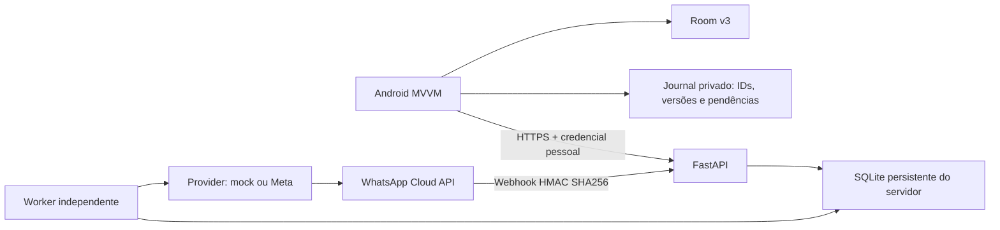

# Integração WhatsApp com FastAPI e SQLite

## Escopo e preservação

Piloto independente do Android. Não usa banco remoto contratado, Firebase, Supabase ou outro SGBD.
O SQLite do servidor (`backend/data/zelo.db`) **não é o banco Room**.
Room permanece versão 3, entidades/DAOs/migrações originais intactos. Não há importação direta de arquivos SQLite Android.
A mudança de dados locais só ocorre após sincronização explícita, pelos repositórios existentes.
A alteração do desenvolvedor em `.idea/deploymentTargetSelector.xml` não faz parte da entrega.

DOC-02 e DOC-03 não estavam presentes no repositório. Os requisitos transcritos na solicitação orientaram a implementação.

## Arquitetura



- `zelo/config.py`: configurações via ambiente ou .env.
- `models.py`, `db.py`: SQLAlchemy, schema inicial v1 do servidor, WAL, foreign_keys e busy_timeout.
- `schemas.py`, `service.py`: validação de registros versionados, vínculos e recorrência.
- `auth.py`: credenciais pessoais opacas, armazenadas como hashes SHA256 na configuração, com clínica e papel.
- `provider.py`: interface Provider, simulação explícita e cliente oficial HTTP da Meta.
- `worker.py`, `worker_lock.py`: descoberta, persistência das tentativas, backoff, exclusão de processos concorrentes.
- `webhooks.py`: assinatura, deduplicação, correlação e respostas.
- `api.py`: registros, histórico, pendências, auditoria, métricas e preferências.
- `bootstrap.py`: inicialização aditiva de uma base **nova do servidor**; PRAGMA user_version=1.
- `pilot.py`: dados fictícios, permitidos somente com PROVIDER=mock.
- `tests/`: SQLite isolado, fakes e HTTP simulado, sem acesso ao Room.

Os registros de tutor, pet, agendamento e procedimento têm UUID, clínica, versão e payload estritamente validado por tipo.
Não há endpoint de remoção. Procedimentos clínicos são imutáveis e apontam para um atendimento concluído.
Um atendimento de origem pode gerar uma regra de recorrência neste piloto.

## Instalação e execução local

Python 3.11+, em um terminal aberto em `backend`:

```powershell
python -m venv .venv
.venv/Scripts/python.exe -m pip install -r requirements.txt
Copy-Item .env.example .env
.venv/Scripts/python.exe -m zelo.bootstrap
.venv/Scripts/python.exe -m uvicorn zelo.api:app --host 127.0.0.1 --port 8000 --no-access-log
```

Para reproduzir exatamente as versões verificadas, instale `requirements.lock` em lugar de `requirements.txt`.

Edite `.env` antes de habilitar o provedor. Ele é ignorado pelo Git.
A URL SQLite é relativa ao diretório de execução: execute os comandos sempre em `backend`, ou configure uma URL absoluta.
O diretório `data` é criado automaticamente. Ele deve ficar em disco persistente local, com acesso restrito ao usuário do serviço.
Não coloque o SQLite em NFS, armazenamento efêmero ou dentro do APK. Faça backups consistentes do SQLite, incluindo WAL quando pertinente.

Em outro terminal no mesmo diretório:

```powershell
.venv/Scripts/python.exe -m zelo.worker
```

**Os lembretes só funcionam continuamente enquanto o backend e o worker estiverem executando.**
O worker não é iniciado no lifespan do FastAPI: múltiplos workers ASGI não criam múltiplos agendadores.
Use um supervisor de processos para reinício automático do serviço.
Um lock de arquivo impede dois processos do comando `zelo.worker` sobre o mesmo banco.

O schema do servidor tem inicialização própria v1. Para mudanças futuras, introduza uma migração versionada do servidor, com backup, sem executar alterações de schema no Room. Esta versão não oferece upgrade automático de bancos de servidor com esquemas diferentes.

## Variáveis de ambiente

| Variável | Uso |
|---|---|
| DATABASE_URL | Apenas SQLite; padrão sqlite:///./data/zelo.db |
| PRINCIPALS_JSON | Lista de hashes de credenciais, clinic_id e role |
| CLINIC_ID | UUID da clínica inicial |
| CLINIC_TIMEZONE | Fuso IANA, padrão America/Sao_Paulo |
| LEAD_DAYS | Antecedência inicial, 0–90 dias |
| PROVIDER | disabled, mock ou meta |
| META_ACCESS_TOKEN | Token do usuário de sistema, apenas no servidor |
| META_PHONE_NUMBER_ID | ID do número empresarial, não o telefone do tutor |
| META_APP_SECRET | Segredo do app para HMAC dos POSTs |
| META_VERIFY_TOKEN | Segredo independente para handshake GET |
| GRAPH_VERSION | Versão configurável, exemplo v25.0; confirmar suporte antes de ativar |
| TEMPLATE_NAME / TEMPLATE_LANGUAGE | Template de confirmação aprovado e idioma exatos |
| DUE_TEMPLATE_NAME | Template aprovado de vencimento clínico, com quatro parâmetros e sem botões de comparecimento; vazio bloqueia esse tipo de envio real |
| MAX_ATTEMPTS / RETRY_SECONDS | Limite e atraso inicial do backoff |
| POLL_SECONDS | Intervalo da rotina; padrão 60 segundos |
| SENDING_TIMEOUT_SECONDS | Tempo para encaminhar tentativa interrompida à recepção |

A antecedência, o fuso e a ativação da clínica também podem ser alterados por um administrador autenticado em `PUT /v1/clinic`.

## Autenticação e isolamento

Gere uma credencial aleatória pessoal com pelo menos 32 caracteres (por exemplo `secrets.token_urlsafe(32)`).
Calcule SHA256 da credencial e configure **somente o hash**:

```json
[{"clinic_id":"11111111-1111-4111-8111-111111111111","role":"reception","token_sha256":"HASH_SHA256_DE_64_CARACTERES"}]
```

Envie a credencial original no cabeçalho `Authorization: Bearer SUA_CREDENCIAL`.
O Android recebe essa credencial de atendente durante a sessão e não a persiste.
Isso **não** é um token da Meta.

Papéis admin e reception podem consultar e sincronizar dados da própria clínica; somente admin altera preferências da clínica.
O papel mobile fica sem acesso a esses endpoints: não há login de tutor nem autorização por tutor implementados.
Não distribua credenciais administrativas a tutores.

A clínica vem da credencial validada; nunca de um clinic_id arbitrário no corpo de uma requisição.
Referências a UUIDs de outra clínica retornam 404; leitura de registros, conversas e auditoria sempre filtra a clínica autenticada.
Para revogar uma credencial, remova seu hash da configuração e reinicie o serviço.

O piloto provisiona uma clínica/número Meta por instância. Os testes exercitam isolamento entre clínicas, mas onboarding multiempresa, gestão de usuários, sessões expirantes e autenticação de tutores ainda não existem.
A área Android é explicitamente de **atendente autorizado**, não um substituto do login ausente do app.
Restrinja o dispositivo usado no piloto e o acesso ao banco do servidor. Não exponha a API diretamente à internet sem TLS e proteção operacional.

## RN-003: desativação e transferência de responsabilidade

O modelo do piloto mantém um tutor por pet. Uma solicitação para desativar um tutor com pets vinculados na mesma clínica retorna HTTP 409, sem modificar dados, versões ou consentimentos anteriores.
Primeiro vincule cada pet a outro tutor ativo da mesma clínica, por atualização versionada; depois desative o antigo tutor.
A recusa é registrada como tutor_deactivation_rejected em transação separada da alteração rejeitada.
Tutor sem pets pode ser desativado; um tutor inativo não pode receber novos vínculos.
A transferência do pet não redireciona automaticamente mensagens de procedimentos históricos: os vínculos são novamente validados antes do envio.

## Simulação local sem mensagens reais

Com `PROVIDER=mock` no .env:

```powershell
.venv/Scripts/python.exe -m zelo.pilot
.venv/Scripts/python.exe -m zelo.worker
```

O fixture grava registros fictícios no SQLite do servidor e ativa somente essa clínica em modo mock.
É idempotente por IDs fixos e não muda as datas de registros já existentes.
O worker grava estado **simulated** e identificador `mock:...`, nunca `delivered`.
Consulte o histórico com credencial autorizada. Nenhum contato HTTP com a Meta acontece nesse modo.
Não use a base fictícia para produção: use um arquivo de servidor separado para o piloto real.

## Cadastrar recorrência e dados reais do piloto

Utilize `PUT /v1/records`, com cabeçalho autenticado. A documentação OpenAPI fica em `/docs`; preencha o cabeçalho Authorization nos endpoints.

Todo envio tem:

```json
{"id":"UUID_ESTAVEL","kind":"tutor","base_version":0,"data":{"name":"Nome autorizado","phone":"+5511999999999","active":true,"consent":true,"reminders_enabled":true,"consent_source":"formulario_v1_assinado"}}
```

Use dados reais apenas com autorização. Ordem: tutor → pet → agendamento → procedimento.
`base_version=0` cria; alterações exigem a versão atual. HTTP 409 preserva a versão do servidor; replay de um corpo já aceito não incrementa a versão.

Payloads dos demais tipos:

```json
{"name":"Nome do pet","tutor_id":"UUID_TUTOR"}
```

```json
{"pet_id":"UUID_PET","tutor_id":"UUID_TUTOR","date":"2026-11-12","time":"10:00","description":"Procedimento realizado","status":"CONCLUIDO","attendance":"pending"}
```

```json
{"pet_id":"UUID_PET","tutor_id":"UUID_TUTOR","description":"Próxima dose","performed_on":"2026-11-12","interval_days":30,"source_appointment_id":"UUID_ATENDIMENTO_CONCLUIDO","appointment_id":"UUID_AGENDAMENTO_FUTURO_OU_NULL"}
```

Use `null` JSON real para appointment_id ausente. As datas são exemplos de formato, não dados fixos do serviço.
A data de origem deve coincidir com o atendimento concluído.
A próxima data é calculada exclusivamente por `performed_on + interval_days`.
Intervalos válidos são 1–3650 dias; `null` não gera lembrete.
A cada nova administração, registre outro procedimento a partir de outro atendimento concluído. O sistema não presume doses realizadas.

A interface Android não cadastra recorrências: a recepção usa este endpoint no piloto.
Agendamentos avulsos nunca disparam lembretes de vencimento sozinhos.

## Scheduler, confiabilidade e estados

A rotina consulta periodicamente as datas no fuso da clínica; portanto verifica os elegíveis todos os dias sem depender do app.
Seleciona ocorrências entre hoje e hoje + antecedência.
A restrição única (clínica, procedimento, vencimento) e a unicidade da origem clínica evitam duplicação de ocorrência.
Todas as transações usam BEGIN IMMEDIATE: SQLite ignora SELECT FOR UPDATE.
As tarefas, contagens e próximos horários são persistentes; reinício não limpa tentativas.

Antes de despachar, revalida tutor ativo, telefone E.164, consentimento, habilitação e vínculos.
A revogação é serializada com o despacho pelo lock do SQLite. A chamada HTTP possui timeout; essa serialização reduz a capacidade do piloto.

Fluxo: pending → sending → sent → delivered → read.
`sent` significa solicitação aceita, **não entrega confirmada**.
Erros transitórios explícitos (429/5xx) e falhas de conexão anteriores ao envio geram retry com backoff exponencial até MAX_ATTEMPTS.
Timeout de leitura ou resultado ambíguo gera unknown e atendimento humano, sem reenvio cego.
Crash após assumir uma tentativa vira unknown após o timeout configurado.
Não é possível prometer exactly-once na fronteira HTTP com a Meta: não se presume suporte a uma chave de idempotência do provedor.
Falha definitiva gera failed e pendência. Consentimento revogado gera suppressed.
Ocorrências elegíveis já vencidas são marcadas missed e encaminhadas à recepção.
`GET /v1/metrics` informa contagens, tentativas, pendências e janelas perdidas; não substitui alertas operacionais ou uma garantia de SLA em produção.

## Vencimento clínico e confirmação de atendimento

O worker reavalia o agendamento tanto na programação quanto antes de despachar, sob a reserva de escrita do SQLite.

| Situação | Mensagem permitida |
|---|---|
| Agendamento AGENDADO, mesmo pet/tutor e data do vencimento | Template de confirmação com os três botões |
| Procedimento sem agendamento | Aviso de vencimento clínico, sem botões de comparecimento |
| Agendamento cancelado, concluído, indisponível ou contexto alterado | Aviso de vencimento clínico, sem confirmar esse atendimento |

A associação é retirada somente do lembrete quando não corresponde mais a um atendimento ativo válido. O procedimento imutável conserva sua referência original, regra e vencimento.
A decisão fica em confirmation_removed, com motivo e ID do agendamento original; o histórico de saída distingue kind=clinical_due de appointment_confirmation.
Cancelar um atendimento não apaga o procedimento nem comprova a administração de uma nova dose. Uma nova ocorrência clínica deve ser registrada explicitamente.
A unicidade do lembrete por ocorrência continua valendo, inclusive quando um cancelamento acontece antes de uma retentativa. Não se envia uma segunda mensagem se a ocorrência já foi processada.
Respostas tardias a mensagens anteriormente enviadas não reabrem um agendamento fechado; são preservadas e encaminhadas à recepção.
Respostas a um aviso exclusivamente clínico também vão para atendimento humano, sem interpretar seus textos ou payloads como confirmação de um horário.

## Meta e webhooks reais

1. Criar/configurar app empresarial Meta e conta WhatsApp Business; verificar o número.
2. Configurar token de usuário de sistema com permissões apropriadas e os segredos no ambiente do servidor.
3. Definir uma versão Graph suportada em GRAPH_VERSION; esta implementação não faz upgrade automático.
4. Aprovar template de utilidade no idioma configurado, com quatro parâmetros posicionais:
   tutor, pet, procedimento, vencimento (dd/MM/yyyy).
5. Configurar TEMPLATE_NAME com os três botões quick_reply nesta ordem: Confirmar, Remarcar, Cancelar.
   Payloads são gerados pelo servidor como `zelo:UUID_DO_LEMBRETE:confirm|reschedule|cancel`.
6. Aprovar também DUE_TEMPLATE_NAME com os mesmos quatro parâmetros e **sem botões de comparecimento**. Se não estiver configurado, o envio clínico falha de forma segura com due_template_not_configured e cria pendência; não há fallback para o template de confirmação.
7. Disponibilizar `/webhooks/whatsapp` por **HTTPS publicamente acessível**, com certificado válido; assinar o campo messages na conta.
8. Configurar o GET de verificação com META_VERIFY_TOKEN. Todo POST exige X-Hub-Signature-256, calculado sobre o corpo bruto com META_APP_SECRET.
9. Configurar PROVIDER=meta e habilitar a clínica via PUT /v1/clinic após revisar consentimentos.
10. Realizar um teste autenticado com destinatário autorizado e acompanhar sent/delivered/read.

Exemplo de corpo para solicitar aprovação do template: “Olá, {{1}}! O cuidado {{3}} de {{2}} está previsto para {{4}}. Para organizar o atendimento, escolha Confirmar, Remarcar ou Cancelar. Equipe da clínica.” Os botões precisam existir na aprovação; não basta incluí-los no texto.

O cliente chama somente graph.facebook.com via HTTPS e usa templates para toda iniciativa automática.
Nenhuma resposta livre é enviada automaticamente, evitando envio fora da janela de atendimento.
A operação humana que responder externamente deverá respeitar a janela de 24 horas ou usar template aprovado.
A Meta precisa aprovar e manter o template ativo. Custos, limites e elegibilidade dependem da conta.

Referências: [política oficial](https://business.whatsapp.com/policy), [documentação Cloud API](https://developers.facebook.com/docs/whatsapp/cloud-api/), [templates e payloads de botões](https://whatsapp.github.io/WhatsApp-Nodejs-SDK/api-reference/types/component_object/), [assinatura de webhooks](https://whatsapp.github.io/WhatsApp-Nodejs-SDK/api-reference/webhooks/start/).
As duas últimas referências são do SDK oficial arquivado e servem como referência de formato; a integração usa HTTP diretamente e deve ser validada contra a documentação Graph vigente antes de produção.

**Não houve envio real autenticado nesta entrega.**

## Respostas e recepção

Só um botão com UUID correto, contexto da mensagem enviada e telefone do tutor correto pode alterar o agendamento associado.
Texto livre não é usado para inferir ações clínicas. Mensagens desconhecidas são preservadas com remetente e geram pendência.
PARAR/SAIR/STOP revogam consentimento do remetente autenticado pelo webhook, inclusive sem contexto de lembrete.

- Confirmar muda attendance para confirmed; status continua AGENDADO.
- Cancelar muda status para CANCELADO e attendance para cancelled, sem excluir dados.
- Remarcar muda attendance para reschedule_requested e abre pendência; não altera data automaticamente.
- Sem agendamento futuro associado: resposta é registrada e cria solicitação de organização de atendimento.
- Agendamento já concluído/cancelado não é reaberto por resposta tardia.

A recepção consulta `GET /v1/communications`, contendo reminders, messages e tickets.
Pode resolver uma pendência em `POST /v1/tickets/{id}/resolve` com `{"note":"Descrição da intervenção"}`.
Cada intervenção entra em auditoria append-only; mensagem original é preservada.
A recepção pode editar o agendamento via registros versionados; uma consulta de disponibilidade rejeita outro atendimento AGENDADO na mesma data/hora da clínica.
Este é um modelo conservador de um horário por clínica, sem duração, profissionais ou salas.
Não há console visual de atendimento nem envio manual de mensagens pelo serviço.

## Android, offline e conflitos

Início → Ver lembretes abre a LembretesScreen original, identificada como demonstrativa, com retorno ao início e a navegação principal preservada.
Perfil → Configurar lembretes pelo WhatsApp abre a WhatsAppActivity específica da integração; voltar retorna ao perfil.
Os dados demonstrativos não são apresentados como mensagens reais do WhatsApp.
Informe URL HTTPS e credencial pessoal de atendente; HTTP e redirecionamentos são recusados.
Mesmo para desenvolvimento Android, configure TLS local confiável ou um servidor HTTPS seu; não há exceção cleartext ou bypass de certificado.

O journal `noBackupFilesDir/whatsapp-sync.json` contém apenas dados de integração, nunca tokens.
AtomicFile preserva gravações; um journal corrompido falha sem regenerar IDs silenciosamente.
UUIDs derivados de instalação + tipo + ID local permanecem estáveis enquanto o journal existir.
O aparelho fica vinculado a uma única clínica; não há troca automática.

- Salvar no aparelho persiste preferências e prepara pendências dos registros locais após vínculo.
- Sem rede, pendências permanecem e os dados originais continuam no Room.
- Sincronizar envia somente dados explicitamente autorizados do tutor local 1, pets vinculados e agenda desses pets.
- Mudanças feitas offline nas telas legadas são detectadas na próxima preparação/sincronização; não há captura por migração ou trigger.
- Upload é ordenado por dependência; cada resposta aceita salva sua versão no journal. Replay após perda de resposta é idempotente.
- GET de registros recupera cancelamentos e alterações da clínica. Atualização do Room usa os repositórios existentes em transação.
- Confirmação permanece no journal/histórico da integração e não vira CONCLUIDO no Room.
- Versões divergentes geram 409. Alterações concorrentes durante o download interrompem a aplicação.
- Room e journal são armazenamentos separados: não existe transação atômica entre ambos. Uma interrupção entre a atualização local e a gravação do journal pode exigir reconciliação explícita, sem sobrescrita silenciosa.
- A ação explícita “usar dados da clínica” resolve usando o servidor para registros já vinculados, após confirmação; registros nunca enviados são preservados.

A sincronização é **manual**, com credencial de sessão, e não funciona em segundo plano no piloto.
O backend continua enviando sem o Android aberto, depois que os dados e consentimentos forem sincronizados.
Revogação offline ainda não alcança o servidor: a interface informa a pendência; responder PARAR ou contatar a recepção é a alternativa imediata.
Não há sincronização de exclusões, onboarding multiaparelho ou recuperação automática do journal após reinstalação. Cadastros removidos/recriados localmente precisam de reconciliação pela recepção; revogue consentimentos no servidor quando aplicável.
Não há login e isolamento por clínica em todas as telas locais legadas; somente a integração remota aplica os controles descritos.
O piloto deve ser usado por um atendente em aparelho dedicado, vinculado a uma clínica e um tutor local.

## Privacidade e operação

Não registre corpo de requisição, cabeçalho Authorization ou segredos em logs.
As conversas, auditorias e pendências exigem credencial e filtro de clínica.
Há minimização de dados enviados: nome e vínculos, telefone/consentimento, data/hora, descrição clínica necessária.
Texto recebido fica limitado a 4096 caracteres; mídia não é baixada nem interpretada.
Auditoria conserva versões, consentimentos, ações e notas; histórico outbound registra template e parâmetros.
Backup, retenção, anonimização, política de privacidade, atendimento aos titulares e proteção do disco precisam ser definidos pela clínica antes de uso real.
Esta implementação não declara certificação de conformidade LGPD.

## Testes e evidências

```powershell
# Em backend
.venv/Scripts/python.exe -m pytest -q

# Na raiz Android
./gradlew.bat app:assembleDebug
./gradlew.bat app:assembleDebugAndroidTest
./gradlew.bat app:testDebugUnitTest
# Com dispositivo de teste conectado:
./gradlew.bat app:connectedDebugAndroidTest
```

Backend: 48 testes passaram na validação completa após as correções de revisão, incluindo duas rotinas concorrentes em arquivo SQLite temporário.
FastAPI foi inicializado localmente e /health verificado; endpoints pessoais rejeitam acesso sem autenticação.
Android: assembleDebug, assembleDebugAndroidTest e testDebugUnitTest passaram; a suíte unitária executou 12 testes.
HistoricoViewModelTest agora exercita o ViewModel e os repositórios reais com DAOs simulados e fluxos controlados; o código de produção não foi alterado para satisfazer testes.
MockK 1.14.6 e kotlinx-coroutines-test 1.10.2 foram adicionados somente em testImplementation, necessários para substituir a criação interna do banco e controlar Dispatchers.Main sem Android nem acesso a dados existentes. Não entram no APK.
O novo LembretesNavigationTest verifica o percurso início → lembretes demonstrativos → perfil → configuração → retorno. Foi compilado, mas a execução depende de dispositivo online. Resultados finais em [validation.md](validation.md).
Há testes instrumentados do journal (persistência, fingerprint e falha segura em corrupção), separados do banco do app.
Testes automatizados não usam credenciais reais nem enviam mensagens.
A suíte Python apresenta um aviso de depreciação do TestClient/HTTPX nas versões instaladas; os testes passam.

## Rastreabilidade

| Requisito | Implementação | Limite / pendência |
|---|---|---|
| RF-008 | Recorrência validada, cálculo, worker, template, persistência, preferências | Credenciais/template/HTTPS e teste Meta real |
| RF-009 | Botões correlacionados, attendance separado, cancelamento, solicitação de remarcação | Remarcação manual pela recepção; sync Android manual |
| RF-010 | Mensagem original, tickets, consulta e resolução autenticadas, auditoria | Console visual e resposta humana pelo sistema |
| RN-002 | Hashes pessoais, papéis, clínica derivada da credencial, consultas isoladas | Login completo do app e gestão de usuários não implementados |
| RN-003 | Vínculos por clínica; tutor ativo; desativação bloqueada enquanto possuir pets; recusa auditada | Um tutor por pet; transferir responsabilidade antes de desativar; piloto Android com tutor local 1 |
| RN-004 | Recorrência no servidor, origem concluída, intervalo válido, sem geração por agenda avulsa | Cadastro de recorrência via API |
| RNF-003 | Tarefas persistentes, backoff, locks SQLite, deduplicação, métricas e tickets de janela perdida | Monitoramento/SLA de produção e resultado externo não garantidos |
